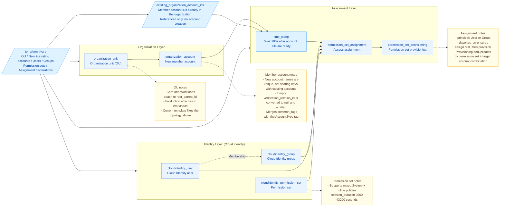

# Centralized Identity and Permission Management for Enterprise Multi-Account

This template is built on Enterprise Organization and Cloud Identity Center. It uses Terraform to uniformly orchestrate the organizational structure, member accounts, identity principals, and access assignments, enabling centralized onboarding and standardized permission delivery for both newly created and existing accounts.

## 1. Business Background

As enterprise business grows, the number of member accounts and the people who use cloud resources keep increasing. If each account maintains its own identities and access permissions, onboarding, offboarding, role changes, and responsibility adjustments all require repeated operations across accounts. This is not only inefficient but also prone to permission and audit risks:

- **Fragmented identity maintenance and high operational cost**: Administrators must repeatedly create, adjust, or delete identities across multiple accounts. The more frequently personnel or the organization changes, the heavier the maintenance workload becomes.
- **Inconsistent authorization standards and configuration errors**: The permissions for the same role may be configured manually by different people in different accounts, leading to missing authorizations, duplicate authorizations, or over-privileged access.
- **Difficult to converge permissions promptly on offboarding and role changes**: After someone's responsibilities change, historical permissions scattered across multiple accounts are hard to fully identify and reclaim, potentially leaving behind access entries that are no longer needed.
- **Hard to audit permission relationships across accounts**: The authorization relationships among accounts, users or user groups, and permission sets are scattered across the console, lacking a unified view and standardized configuration, making them hard to review, verify, and trace.
- **Inconsistent onboarding for new and existing accounts**: Newly created member accounts and existing accounts already in the organization need a consistent approach to identity and permission management; otherwise, two separate maintenance processes easily emerge.

This solution centrally manages member accounts, users, user groups, permission sets, and access assignments through Enterprise Organization and Cloud Identity Center, and uses Terraform to declare the desired state of the first deployment. It turns the organizational structure and authorization relationships into reviewable, repeatably executable configurations, reducing the complexity and the risk of human error in multi-account identity and permission management.

## 2. Solution Overview

This solution adopts a layered, decoupled design across "organization, identity, permission, and assignment." Enterprise Organization defines the hierarchy and resource boundaries of member accounts. Cloud Identity Center uniformly manages users and user groups. Permission sets accumulate role-based permission templates. Access assignments establish the relationships among users or user groups, permission sets, and target accounts. Each layer is connected through stable logical keys, so the organizational structure and permission relationships can be declared uniformly, maintained independently, and reviewed before deployment.



The solution is implemented with four Terraform modules:

- **Organization management**: `organization` creates the Core, Workloads, and Production organization units following a fixed topology, and creates member accounts in the specified organization units.
- **Identity management**: `identity` creates Cloud Identity Center users and user groups, and maintains the membership relationships between users and user groups.
- **Permission modeling**: `permission-set` encapsulates system policies or custom policies into reusable permission sets, uniformly defining the session duration and the initial page after login.
- **Access assignment**: `access` associates users or user groups, permission sets, and target accounts, and provisions the permission sets to the target accounts after the assignment is complete.

In terms of implementation, the root module acts as the single entry point, connecting the modules through stable logical keys, and uses input validation, cross-input checks, and resource preconditions to block invalid references. Newly created member accounts are created and have their configuration maintained by Terraform; existing member accounts are only used as authorization targets via their account IDs, and the template does not modify their organization units, tags, or lifecycle. Resource references explicitly establish the organization unit hierarchy, the user group membership relationships, and the "assign first, then provision the permission set" execution dependency.

## 3. IaC Design

### 3.1 Resource Inventory

After filling in the parameters based on the current `terraform.tfvars` example, it is expected to create seven kinds of cloud resources, a total of 22 cloud resource instances, and reference 1 existing member account. The resource count varies with the account, identity, and assignment configuration. The example counts are as follows:

| Terraform Resource                                             | Purpose                                                                 |
| ------------------------------------------------------------ | ----------------------------------------------------------------------- |
| `volcenginecc_organization_unit` × 3                         | Core, Workloads, and Production organization units                      |
| `volcenginecc_organization_account` × 5                      | New Ops, Security, Logging, Production, and Staging accounts            |
| `volcenginecc_cloudidentity_user` × 2                        | Platform administrator and auditor                                      |
| `volcenginecc_cloudidentity_group` × 2                       | Admin group and audit group, including membership relationships         |
| `volcenginecc_cloudidentity_permission_set` × 2              | Administrator and read-only permissions                                 |
| `volcenginecc_cloudidentity_permission_set_assignment` × 4   | Authorize user groups to access new or existing accounts                |
| `volcenginecc_cloudidentity_permission_set_provisioning` × 4 | Sync permission sets to target accounts after assignment is complete    |
| `time_sleep` × 1                                             | Waits 180s when there are access assignments; not created when none; not a cloud resource |

The example totals 23 managed instances. Existing accounts are only referenced and are not counted as managed account resources; the template does not manage their accounts, OUs, tags, or lifecycle. The wait is a fixed buffer and does not represent an account-sync readiness check. The number of access assignments is determined by `permission_set_assignments`, and the number of permission set provisioning operations is determined by the distinct "permission set + target account" combinations among them.

The assignment instance key is derived from "permission set + principal type + principal + account"; permission set provisioning is deduplicated by "permission set + account." New account IDs come from the `organization` module output, and existing account IDs come from `existing_organization_account_ids`; after merging, they are provided to the `access` module.

### 3.2 Project Structure

```text
.
├── main.tf / variables.tf / locals.tf / outputs.tf
├── checks.tf
├── providers.tf / versions.tf
├── terraform.tfvars
└── modules/
    ├── organization/
    ├── identity/
    ├── permission-set/
    └── access/
```

The root `main.tf` calls the four modules, and the cloud resources are defined directly inside the modules.

`variables.tf` validates field formats, uniqueness, and value ranges; `checks.tf` centrally diagnoses cross-input references for account OUs, user passwords, group memberships, and assignments. A failed Terraform `check` only produces a warning; hard blocking is enforced by variable validation and the `lifecycle.precondition` on the corresponding real cloud resources, without adding helper resources.

The `account_name` values in the new account list must not be duplicated, nor can they be the same as account names in `existing_organization_account_ids`; conflicts raise an error and block execution during the Plan phase.

### 3.3 Core Code Examples

#### 3.3.1 Defining the Organization Hierarchy

```hcl
organization_units = [
  {
    key           = "ou_core"
    name          = "Core-T20261014C"
    parent_ou_key = ""
  },
  {
    key           = "ou_workloads"
    name          = "Workloads-T20261014C"
    parent_ou_key = ""
  },
  {
    key           = "ou_production"
    name          = "Production-T20261014C"
    parent_ou_key = "ou_workloads"
  },
]
```

Core and Workloads sit under the enterprise organization root node, and Production attaches under Workloads via `parent_ou_key`.

#### 3.3.2 Defining a Permission Set

```hcl
permission_sets = [{
  key              = "ps_readonly"
  name             = "CISecurityRead20261014C"
  description      = "Read-only permission for security audit"
  session_duration = 7200
  permission_policies = [{
    permission_policy_name     = "ReadOnlyAccess"
    permission_policy_type     = "System"
    permission_policy_document = ""
  }]
}]
```

This configuration creates a permission set containing the preset system policy `ReadOnlyAccess` and sets the login session duration to 7200 seconds.

#### 3.3.3 Establishing an Access Assignment

```hcl
permission_set_assignments = [{
  permission_set_key = "ps_readonly"
  principal_type     = "Group"
  principal_key      = "grp_security_audit"
  target_account_key = "ci-t20261010a-ops"
}]
```

This configuration allows the audit group to use the read-only permission set to access an existing Ops account. After the assignment is created, the `access` module provisions the corresponding permission set to the target account.

### 3.4 First-Deployment Boundary and Subsequent Permission Operations

This template is used to complete the first deployment: create permission sets, establish access assignments from users or user groups to target accounts, and perform the initial provisioning of permission sets to both newly created and existing accounts. After the first deployment is complete and the status is `Provisioned`, all subsequent permission operations are performed uniformly in the **Cloud Identity Center console**, no longer by modifying parameters and re-applying.

1. **Modify permission set policies**: Go to the permission set list or permission set details in Cloud Identity Center, edit the system policies, custom policies, session duration, and other settings, and save.
2. **Re-provision policies**: Go to the "Permission Sets" page in Cloud Identity Center, hover over the permission set that needs to be synced, and click "Start Sync." After the sync completes, confirm that the target account's deployment status returns to `Provisioned`.
3. **Add account authorizations**: Go to Account Access Assignments, select the target account, user or user group, and permission set. After creating the assignment, confirm that the sync task runs successfully.
4. **Adjust the assignment principal or target account**: Go to Account Access Assignments, confirm the business impact, revoke the old assignment, and then create the new one. Verify separately that the old entry has disappeared and the new entry can be accessed normally.
5. **Delete an authorization**: In Account Access Assignments, revoke the access relationship of the user or user group, wait for the background task to finish, and confirm that the user portal no longer shows the account.
6. **Adjust user group membership**: Go to the user group details to add or remove members, then log in again as an affected employee to confirm that the accounts and permission scope meet expectations.

When you later modify permission set policies, updating the permission set itself does not mean the already-authorized accounts take effect immediately. If the deployment status shows `ReprovisionRequired`, you must follow the steps above and click "Start Sync" on the "Permission Sets" page; do not trigger the sync by deleting the permission set provisioning resource, deleting the entire stack, or repeatedly applying.

After manually adjusting permissions in the console, the cloud configuration may diverge from the records in the stack. Before continuing to use the template, you should first reconcile and sync the parameters to avoid old parameters overwriting the permission configuration already in effect.

## 4. Usage

This project supports one-click deployment on the cloud through InfraManager, or downloading the template to run locally. Cloud deployment is recommended, as it does not require preparing a Terraform runtime yourself—you only need to fill in parameters on the platform to complete resource creation and hosting.

### 4.1 Cloud Deployment

InfraManager is the Terraform-managed workbench provided by Volcengine. For more product information, see [InfraManager Product Introduction](https://docs.volcengine.com/docs/infrastructure-management/product-introduction?lang=zh).

#### 4.1.1 Preparing Permissions

Using an authorized identity under the organization administrator account, first enable Enterprise Organization and Cloud Identity Center in the console and obtain the enterprise organization root OU ID. The executing identity needs CloudControl resource operation permissions, as well as the corresponding operation permissions for enterprise organization OUs, member accounts, Cloud Identity Center users, user groups, permission sets, access assignments, and permission set provisioning. Execute with an IAM identity or an assumed role, and grant permissions according to the actual resource scope.

#### 4.1.2 Selecting the Template

Upload this project as a custom template to the [InfraManager Console](https://console.volcengine.com/iac), or go to **Template Management > Public Templates** and search for "Centralized Identity and Permission Management for Enterprise Multi-Account."

#### 4.1.3 Creating the Resource Stack

When creating the resource stack, first fill in the template parameters, then **set the execution concurrency to 1**. When creating via the API, the corresponding execution parameter is `Parallelism = 1`; do not use the default concurrency. This is a runtime setting, not a business variable in `terraform.tfvars`.

`terraform.tfvars` is a delivery example, and `variables.tf` defines the parameter types, default values, and validation. Before deployment, you must replace the root OU ID, existing account IDs, resource names, emails, and user initial passwords with the actual configuration for the target environment; do not directly use the example batch names or example passwords. Existing accounts must already be part of the current enterprise organization, and account IDs must be mutually unique numeric strings. Passwords can be filled in the platform's sensitive parameters or passed through `cloud_identity_user_passwords`; do not commit real passwords to the code repository.

| Parameter                           | Purpose                                                        |
| ----------------------------------- | -------------------------------------------------------------- |
| `region`                            | Provider region                                                |
| `project`                           | Project tag                                                    |
| `environment`                       | Environment tag                                                |
| `root_parent_id`                    | Real enterprise organization root OU ID                        |
| `organization_units`                | OU definitions                                                 |
| `organization_accounts`             | New account definitions and their OUs                          |
| `existing_organization_account_ids` | Mapping of existing account names to account IDs, for authorization only |
| `cloud_identity_users`              | User definitions                                               |
| `cloud_identity_user_passwords`     | Sensitive initial passwords indexed by user key                |
| `cloud_identity_groups`             | User group definitions and member user keys                    |
| `permission_sets`                   | Permission sets and policies                                   |
| `permission_set_assignments`        | Authorization relationships among principals, permission sets, and accounts |

Passwords must be 8–32 characters and include at least three of the following: uppercase, lowercase, digits, and special characters. Do not commit passwords. The sensitive marking only hides the display; it does not encrypt the State.

When creating only new accounts, set `existing_organization_account_ids` to `{}` and remove the corresponding assignment entries for existing accounts; when reusing only existing accounts, set `organization_accounts` to `[]`, and when no new OU is needed, also set `organization_units` to `[]`. For a mix of new and existing, fill in both sets of account parameters and use `target_account_key` to choose the authorization target. The above describes first-deployment scenarios; in an existing deployment, removing list items produces a resource deletion plan, so you should review the changes first and must not use this to bypass the requirement of manually deleting accounts.

Create and review the execution plan, confirm that the resource scope and authorization targets meet expectations, and then execute the deployment. The template itself does not automatically enforce concurrency of 1, nor does it automatically prohibit resource destruction; the operator must follow these runtime requirements.

#### 4.1.4 Deployment Verification

On the resource stack detail page, confirm that the deployment status is successful, and review the resource inventory and the following outputs. Verification uses the actual IDs from the resource stack outputs, and does not require local Terraform State.

| Output                               | Purpose                                               |
| ------------------------------------ | ----------------------------------------------------- |
| `organization_unit_ids`              | OU IDs                                                 |
| `organization_account_ids`           | Account IDs                                            |
| `cloud_identity_user_ids`            | User IDs                                               |
| `cloud_identity_group_ids`           | User group IDs                                         |
| `permission_set_ids`                 | Permission set IDs                                     |
| `permission_set_assignment_ids`      | Assignment IDs                                         |
| `permission_set_provisioning_status` | Permission set provisioning status after assignment   |

| Check Item          | Entry and Operation                                                              | Expected Result and Troubleshooting                                                                                                                                 |
| ------------------- | -------------------------------------------------------------------------------- | ------------------------------------------------------------------------------------------------------------------------------------------------------------------- |
| OU and account placement | In the Enterprise Organization console, view OUs and member accounts by the output IDs | Core and Workloads attach to the root node, Production attaches to Workloads; new accounts are in the specified OU. For anomalies, first check the root OU ID and `org_unit_key` |
| Users and group membership | In Cloud Identity Center, view users, user groups, and member lists             | The admin group contains the platform administrator, and the audit group contains the auditor; for anomalies, check user keys, group member keys, and password inputs |
| Permissions and provisioning | In Cloud Identity Center, view permission set policies, account access assignments, and sync tasks | The admin permission set contains `AdministratorAccess`, and the read-only permission set contains `ReadOnlyAccess`; target accounts are correct, and assignment and sync tasks have succeeded. For anomalies, check whether the account has joined the organization, the execution permissions, and the cause of failed tasks |
| Employee login effect | Each of the two user types logs in through the customer's Cloud Identity Center user portal, selects an authorized account and permission set | The example administrator can access the new Ops account and the existing Ops account, and the auditor can access the new Production account and the existing Production account; accounts not authorized should not be opened for access by this template. For anomalies, check for other extra authorizations, group membership, and sync status, and log in again using an independent session |

Successful resource creation and non-empty outputs cannot replace employee login and permission-effect verification. After completing the resource check, you should also confirm the admin permission and read-only permission boundaries according to the customer's required business operations; after modifying policies, recheck the sync status, and do not use full-stack destruction as a substitute for sub-account console interactive deletion.

### 4.2 Local Deployment

You can also download this project template and run it locally, following the steps below.

#### 4.2.1 Environment Preparation

Install Terraform 1.5.7 or later, confirm you can download the locked Provider, and complete the same service enablement, root OU ID, and permission preparation as for cloud deployment. Before deployment, check the member account quota and the organization placement of existing accounts. Provide credentials through the runtime environment, and do not write actual AK/SK into Terraform files or the delivery package:

```bash
export VOLCENGINE_ACCESS_KEY="<YOUR_ACCESS_KEY>"
export VOLCENGINE_SECRET_KEY="<YOUR_SECRET_KEY>"
```

Replace the root OU ID, existing account IDs, resource names, and emails in the example with the customer's actual values; do not deploy directly while leaving empty account IDs.

User initial passwords can be filled directly in `cloud_identity_user_passwords` in `terraform.tfvars`. If you instead provide them via environment variables, first delete or comment out the entire assignment block of the same name in the parameter file, then set:

```bash
export TF_VAR_cloud_identity_user_passwords='{"platform_admin":"<ADMIN_INITIAL_PASSWORD>","auditor":"<AUDITOR_INITIAL_PASSWORD>"}'
```

Replace the placeholder values with actual passwords that comply with the password rules, and do not write the passwords back into the delivery example or commit them to the repository. The State may also contain passwords, so restrict access and store it securely.

#### 4.2.2 Scenario-Based Deployment Examples

Choose the new, existing, or mixed account scenario, adjust the parameters according to the rules, and then run. **Account creation does not support concurrency greater than 1, so both Plan and Apply must explicitly use** **`-parallelism=1`.** Even in the existing-account scenario where there is no account creation, keep the same execution approach to avoid missing the restriction when new accounts are added later.

```bash
terraform init
terraform fmt -check -recursive
terraform validate
terraform plan -parallelism=1
terraform apply -parallelism=1
```

Review the Plan first, confirm that it does not include unexpected deletions or account replacements, and then execute Apply. A concurrency of 1 only limits the number of simultaneous operations; it does not guarantee that accounts are created in list order.

#### 4.2.3 Expected Deployment Results

After filling in the parameters based on the current example, it is expected to create 22 cloud resources and 1 wait resource, a total of 23 managed instances, and reference 1 existing account. After the new accounts are created and return their IDs, it waits 180 seconds and then performs access assignments for the new and existing target accounts in the configuration, deduplicating provisioning by "permission set + account." Filling in existing account IDs does not grant permissions by itself; only the relationships declared in `permission_set_assignments` create assignments.

Use the following command to view the outputs; the output names and purposes are shown in the deployment verification output table above:

```bash
terraform output
```

Running `terraform plan -parallelism=1` again with the same inputs should produce no unexpected changes; if deletions or replacements appear, first reconcile the parameters and the console resources, and do not execute Apply directly.

#### 4.2.4 Post-Deployment Verification

After deployment, the customer completes the following business checks from the corresponding product consoles:

| Check Location        | Check Item                                                   | Expected Result                                                                                                            |
| --------------------- | ------------------------------------------------------------ | -------------------------------------------------------------------------------------------------------------------------- |
| Enterprise Organization | View OUs and member accounts                                 | The OU hierarchy matches the configuration, and new accounts are in the specified OU; existing accounts keep their original OU and account information |
| Cloud Identity Center | View users, user groups, permission sets, account access assignments, and deployment status | User group members, permission set policies, and authorized accounts match the template parameters; the deployment status is `Provisioned`, and subsequent adjustments follow the operations rules above |
| User Portal           | Log in as the administrator and the auditor respectively     | Users can see and enter their authorized accounts; the administrator has management permissions, and the auditor has read-only permissions; unauthorized accounts are not visible |

If the check results do not meet expectations, first review the authorization relationships and sync tasks in Cloud Identity Center, confirm that the account has joined the enterprise organization and that the group members and authorization targets are filled in correctly, and then decide whether to re-sync or adjust the configuration.

#### 4.2.5 Destroying Resources

**Do not run** **`terraform destroy`** **or trigger full-stack resource destruction of this template through InfraManager.** The sub-accounts created by this template need to be deleted or deregistered in the console after human interaction such as a security phone number and identity verification; Terraform cannot complete this process automatically. Moving a member account out of the enterprise organization is not the same as deregistering the account, and an account disappearing from the organization list cannot be used as evidence of complete deletion.

When cleanup is needed, handle it manually within the customer's authorized scope in the following order:

1. Reconcile the template outputs with the actual resources, and confirm that you are only cleaning up resources created by this template that are no longer in use. Existing accounts are not within the scope of account deletion; first handle the prerequisites for business data, cloud resources, and billing.
2. In Cloud Identity Center, revoke the account access assignments created by this template, and handle the permission set provisioning relationships as prompted by the console. After confirming no other business uses them, clean up the permission sets, user groups, and users created by this template.
3. In Enterprise Organization member management, locate the sub-accounts created by this template, and as needed set a security phone number, enable login, and complete verification. See [Set an Account Security Phone Number](https://docs.volcengine.com/docs/EnterpriseOrganization/Setaccountsecurityphone?lang=zh).
4. Using an authorized identity of the account to be deleted, go to the security settings page in account management, and follow the [Account Deregistration Process](https://docs.volcengine.com/docs/account_related/Accountcancellation?lang=zh) to complete identity verification, resource and billing checks, and deregistration confirmation, taking the final account status shown in the console as authoritative.
5. After the sub-accounts and their related relationships are handled, confirm that the OUs created by this template have no members or child OUs, then delete the OUs that are no longer in use from the bottom up; do not delete the customer's existing accounts or the enterprise organization root node.

Manual cleanup will cause the cloud resources to diverge from the Terraform State and the stack records. Retain the cleanup results and have operations personnel reconcile them before handling the management records; do not run Apply again directly, to avoid recreating cleaned-up resources. The template code itself does not set up automatic destruction protection, so this restriction must be enforced as an operational norm.

## 5. Summary

The main advantages of this solution:

- **Centralized orchestration for higher delivery efficiency**: A single Terraform configuration uniformly declares organization units, member accounts, users, user groups, permission sets, and access assignments, reducing repeated configuration across consoles.
- **Unified authorization for lower configuration risk**: Permissions are managed centrally based on user groups and permission sets, supporting authorization to both newly created and existing member accounts, making it easy to uniformly control access scope by role.
- **Reviewable changes**: Stable logical keys associate accounts, users or user groups, and permission sets, and the Terraform execution plan shows resource differences, making it easy to review the scope of changes before deployment.
- **Standardized and reusable**: A modular structure, input validation, and scenario-based examples solidify the deployment rules, making it easy for different teams and environments to reuse a consistent multi-account identity and permission configuration.

The current template focuses on the first deployment. During deployment, the execution parallelism must be set to 1; after deployment, you should verify the organizational structure, user groups, permission sets, account assignments, and user access results. Subsequent permission adjustments are completed uniformly in the Cloud Identity Center console; when cleaning up member accounts, follow the console process and do not run `terraform destroy` for a full destruction.

Going forward, you can further integrate an enterprise identity source or SCIM synchronization, approval workflows, remote Terraform state storage, and audit pipelines, turning approved identity and permission changes into reviewable configurations while retaining execution results and audit evidence.
