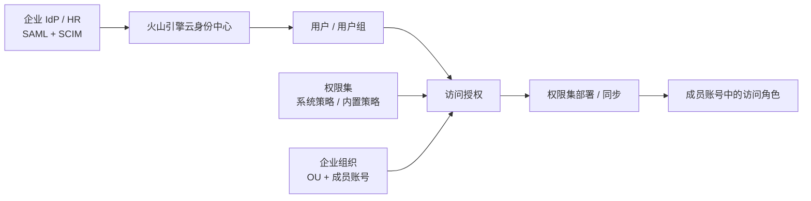

# 火山引擎多账号身份权限集中管理

本工程使用 Terraform `volcenginecc` Provider，实现火山引擎企业组织、云身份中心、权限集和访问授权的集中管理。

## 架构



仓库根目录是资源栈平台入口。平台从根目录执行 `terraform init`、`terraform plan`、`terraform apply`，在同一个 State 中按依赖顺序完成组织、账号、身份、权限集部署和授权，不依赖任何 Shell 脚本。

仓库根目录是唯一部署入口，使用单 State，无跨栈依赖。

权限集部署按“权限集 + 目标账号”去重。多个组使用同一权限集访问同一账号时，只创建一个 provisioning，避免 Provider 侧重复资源冲突。

## 目录

```text
.
├── main.tf                       # 资源栈平台默认入口
├── variables.tf                  # 平台参数定义
├── outputs.tf                    # 平台部署输出
├── providers.tf / versions.tf
├── terraform.tfvars.example
├── modules/
│   ├── account-onboarding/
│   ├── cloud-identity-group/
│   ├── cloud-identity-user/
│   ├── identity-source/
│   ├── organization-account/
│   └── permission-set/
└── .terraform.lock.hcl
```

## 前置条件

1. 使用企业组织管理员账号，已开通企业组织和云身份中心。
2. Terraform `>= 1.5`，Provider `volcengine/volcenginecc ~> 0.0.70`。
3. 部署身份至少具备 Cloud Control、企业组织和云身份中心所需权限。
4. 准备企业组织根 OU ID。
5. 资源栈平台负责 State 托管；本地运行时应使用远程 State 和锁。

## 资源栈平台一键部署

1. 将整个目录上传或发布为资源栈模板源码，入口保持仓库根目录。
2. 在平台创建资源栈。平台会自动从 `terraform init` 开始，无需配置启动脚本。
3. 填写必填参数 `root_parent_id`，并按需填写 OU、账号、用户、组、权限集与授权参数。
4. 创建执行计划并确认后部署。

资源栈一键部署的默认行为：

- `identity_source_mode = "local"`，无需预先配置 SAML/SCIM。
- `skip_financial_relation_gate = true`，避免创建账号后等待人工财务配置导致资源栈失败。
- 所有资源在一个 State 中，账号 ID 直接传递给权限集部署和访问授权。
- OU 使用 `Core → Workloads → Production` 显式依赖链创建，默认并发下不会同时提交企业组织 OU 变更。
- 新成员账号创建后默认等待 180 秒，再按“访问授权 → 权限集部署/同步”的顺序配置云身份中心。
- 默认清单为空，不会意外创建成员账号；可参考根目录 `terraform.tfvars.example` 填写平台参数。

SAML/SCIM 和财务关系属于控制台侧能力。生产环境完成配置后，可将相应门禁参数改为严格模式。

## 本地验证

准备凭据和参数：

```bash
export VOLCENGINE_ACCESS_KEY="<access-key>"
export VOLCENGINE_SECRET_KEY="<secret-key>"
export VOLCENGINE_REGION="cn-beijing"
cp terraform.tfvars.example terraform.tfvars
```

从根目录执行与资源栈平台相同的流程：

```bash
terraform init
terraform validate
terraform plan
terraform apply
```

选择身份源模式：

| 模式 | 要求 |
| --- | --- |
| `local` | Terraform 创建本地用户和手工组 |
| `saml` | 控制台完成 SAML，`saml_configured = true` |
| `saml_scim` | 控制台完成 SAML 和 SCIM，两个状态均为 `true` |

## SCIM 主体

SCIM 同步的用户和组应由 IdP/HR 系统维护，不要在 `cloud_identity_users` 或 `cloud_identity_groups` 中重复创建。将同步后获得的云身份中心 ID 登记为外部主体：

```hcl
external_principals = {
  grp_platform_scim = {
    principal_type = "Group"
    principal_id   = "group-id-from-cloud-identity"
  }
}
```

授权时使用同一个逻辑 key：

```hcl
{
  permission_set_key = "ps_readonly"
  principal_type     = "Group"
  principal_key      = "grp_platform_scim"
  target_account_key = "account-production"
  target_account_id  = ""
}
```

## 安全边界

- 资源栈删除前必须先完成成员账号内资源、账单、日志和密钥迁移，并确认 Provider 的账号退出语义；生产环境应对资源栈删除启用平台审批。
- 密码只通过敏感环境变量 `TF_VAR_cloud_identity_user_passwords` 注入，禁止写入 tfvars。
- SAML、SCIM、财务关系当前由控制台完成，Terraform 只提供显式门禁，不伪装成已自动化。
- 生产授权优先使用用户组，不直接授权个人；高权限权限集应使用短会话并配合 MFA。
- `terraform.tfstate` 可能包含敏感值，必须加密存储并限制访问。

## 校验

```bash
terraform fmt -check -recursive
terraform init
terraform validate
```

内置检查会拒绝重复 key、无效 OU 引用、超过三层或成环的 OU、无效主体引用、同时填写两个目标账号字段、SCIM 组与 Terraform 组混管、无效 Inline JSON 等配置。

## 官方参考

- [火山引擎云身份中心](https://www.volcengine.com/product/cloud-identity)
- [SAML SSO 配置](https://docs.volcengine.com/docs/7165/1217035)
- [云身份中心配额](https://docs.volcengine.com/docs/7165/2603906)
- [Terraform volcenginecc Provider](https://registry.terraform.io/providers/volcengine/volcenginecc/latest)
