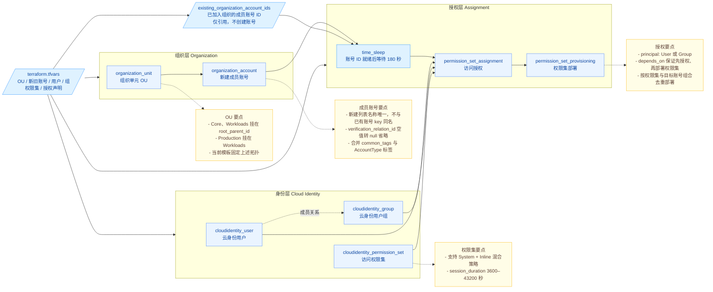

# 企业多账号身份权限集中管理

本模板基于企业组织和云身份中心，使用 Terraform 统一编排组织结构、成员账号、身份主体及访问授权，实现新建与存量账号的集中接入和标准化权限交付。

## 1. 业务背景

随着企业业务扩展，成员账号和使用云资源的人员持续增加。若各账号分别维护身份和访问权限，人员入职、离职、转岗以及职责调整都需要跨账号重复操作，不仅效率低，也容易形成权限和审计风险：

- **身份维护分散，操作成本高**：管理员需要在多个账号中重复创建、调整或删除身份，人员或组织变化越频繁，维护工作量越大。
- **授权标准不一致，容易配置错误**：同一岗位在不同账号中的权限可能由不同人员手工配置，容易出现漏授权、重复授权或权限过大的情况。
- **离职和转岗权限难以及时收敛**：人员职责变化后，分散在多个账号中的历史权限难以完整识别和回收，可能遗留不再需要的访问入口。
- **多账号权限关系难以审计**：账号、用户或用户组、权限集之间的授权关系分散在控制台中，缺少统一视图和标准化配置，难以评审、复核和追溯。
- **新旧账号接入方式不统一**：新建成员账号与已加入组织的存量账号需要采用一致的身份和权限管理方式，否则容易形成两套维护流程。

本方案通过企业组织和云身份中心集中管理成员账号、用户、用户组、权限集及访问授权，并使用 Terraform 声明首次部署的期望状态，将组织结构和授权关系转化为可评审、可重复执行的配置，降低多账号身份权限管理的复杂度和人为错误风险。

## 2. 方案概述

本方案采用“组织、身份、权限、授权”分层解耦的设计。企业组织定义成员账号的层级和资源边界，云身份中心统一管理用户与用户组，访问权限集沉淀岗位权限模板，访问授权建立用户或用户组、访问权限集与目标账号之间的关系。各层通过稳定的逻辑键关联，使组织结构和权限关系可以统一声明、独立维护并在部署前审查。



方案由四个 Terraform 模块实现：

- **组织管理**：`organization` 按固定拓扑创建 Core、Workloads 和 Production 组织单元，并在指定组织单元中创建成员账号。
- **身份管理**：`identity` 创建云身份中心用户和用户组，并维护用户与用户组之间的成员关系。
- **权限建模**：`permission-set` 将系统策略或自定义策略封装为可复用的访问权限集，统一定义会话时长和登录后的初始页面。
- **访问授权**：`access` 将用户或用户组、访问权限集与目标账号关联，并在授权完成后向目标账号部署访问权限集。

实现上，根模块作为唯一入口，通过稳定逻辑键连接各模块，并使用输入校验、跨输入检查和资源前置条件阻断无效引用。新建成员账号由 Terraform 创建并维护配置；已有成员账号仅以账号 ID 作为授权目标，模板不修改其组织单元、标签或生命周期。资源引用显式建立组织单元层级、用户组成员关系以及“先授权、后部署访问权限集”的执行依赖。

## 3. IaC 设计

### 3.1 资源清单

按当前 `terraform.tfvars` 示例补齐参数后，预计创建七种云资源、共 22 个云资源实例，并引用 1 个已有成员账号。资源数量随账号、身份及授权配置变化，示例数量如下：

| Terraform 资源                                                 | 用途                              |
| ------------------------------------------------------------ | ------------------------------- |
| `volcenginecc_organization_unit` × 3                         | Core、Workloads、Production 组织单元  |
| `volcenginecc_organization_account` × 5                      | 新建运维、安全、日志、生产、预发账号              |
| `volcenginecc_cloudidentity_user` × 2                        | 平台管理员和审计员                       |
| `volcenginecc_cloudidentity_group` × 2                       | 管理员组和审计组，包含成员关系                 |
| `volcenginecc_cloudidentity_permission_set` × 2              | 管理员和只读权限                        |
| `volcenginecc_cloudidentity_permission_set_assignment` × 4   | 授权用户组访问新建或已有账号                  |
| `volcenginecc_cloudidentity_permission_set_provisioning` × 4 | 授权完成后向目标账号同步权限集                 |
| `time_sleep` × 1                                             | 有访问授权时等待 180 秒，无访问授权时不创建；不创建云资源 |

示例合计 23 个受管实例。已有账号仅被引用，不计入受管账号资源；模板不管理其账号、OU、标签或生命周期。等待是固定缓冲，不代表账号同步就绪检测。访问授权数量由 `permission_set_assignments` 决定，权限集同步数量由其中不同的“权限集＋目标账号”组合决定。

授权实例键来自“权限集＋主体类型＋主体＋账号”；权限集同步按“权限集＋账号”去重。新建账号 ID 来自 organization 模块输出，已有账号 ID 来自 `existing_organization_account_ids`，合并后提供给 access 模块。

### 3.2 工程结构

```text
.
├── main.tf / variables.tf / locals.tf / outputs.tf
├── checks.tf
├── providers.tf / versions.tf
├── terraform.tfvars
└── modules/
    ├── organization/
    ├── identity/
    ├── permission-set/
    └── access/
```

根 `main.tf` 调用四个模块，模块内直接定义云资源。

`variables.tf` 校验字段格式、唯一性和取值范围；`checks.tf` 集中诊断账号 OU、用户密码、组成员及授权的跨输入引用。Terraform 的 `check` 失败只产生警告，强制阻断由变量校验及对应真实云资源的 `lifecycle.precondition` 执行，不增加辅助资源。

新建账号列表内的 `account_name` 不允许重复，也不能与 `existing_organization_account_ids` 的账号名称相同；冲突会在 Plan 阶段报错并阻断执行。

### 3.3 核心代码示例

#### 3.3.1 定义组织层级

```hcl
organization_units = [
  {
    key           = "ou_core"
    name          = "Core-T20261014C"
    parent_ou_key = ""
  },
  {
    key           = "ou_workloads"
    name          = "Workloads-T20261014C"
    parent_ou_key = ""
  },
  {
    key           = "ou_production"
    name          = "Production-T20261014C"
    parent_ou_key = "ou_workloads"
  },
]
```

Core 和 Workloads 位于企业组织根节点下，Production 通过 `parent_ou_key` 挂在 Workloads 下。

#### 3.3.2 定义访问权限集

```hcl
permission_sets = [{
  key              = "ps_readonly"
  name             = "CISecurityRead20261014C"
  description      = "安全审计只读权限"
  session_duration = 7200
  permission_policies = [{
    permission_policy_name     = "ReadOnlyAccess"
    permission_policy_type     = "System"
    permission_policy_document = ""
  }]
}]
```

该配置创建一个包含系统预设策略 `ReadOnlyAccess` 的访问权限集，并将登录会话时长设置为 7200 秒。

#### 3.3.3 建立访问授权

```hcl
permission_set_assignments = [{
  permission_set_key = "ps_readonly"
  principal_type     = "Group"
  principal_key      = "grp_security_audit"
  target_account_key = "ci-t20261010a-ops"
}]
```

该配置允许审计组使用只读访问权限集访问已有运维账号。授权创建完成后，`access` 模块会向目标账号部署对应的访问权限集。

### 3.4 首次部署边界与后续权限运维

本模板用于完成首次部署：创建权限集、建立用户或用户组到目标账号的访问授权，并将权限集初次部署到新建账号和已有账号。首次部署完成且状态为 `Provisioned` 后，后续权限运维统一在**云身份中心控制台**执行，不再通过修改参数重复 Apply。

1. **修改权限集策略**：进入云身份中心的权限集列表或权限集详情，编辑系统策略、自定义策略、会话时长等配置并保存。
2. **重新下发策略**：进入云身份中心的“访问权限集”页面，将鼠标悬停在需要同步的权限集上，点击“开始同步”。同步完成后，确认目标账号的部署状态恢复为 `Provisioned`。
3. **新增账号授权**：进入账号访问授权，选择目标账号、用户或用户组及权限集。创建授权后确认同步任务执行成功。
4. **调整授权主体或目标账号**：进入账号访问授权，确认业务影响后撤销旧授权，再创建新授权。分别核对旧入口已经消失、新入口可以正常访问。
5. **删除授权**：在账号访问授权中撤销用户或用户组的访问关系，等待后台任务结束，并确认用户门户不再显示该账号。
6. **调整用户组成员**：进入用户组详情增删成员，再使用受影响的员工身份重新登录，确认账号和权限范围符合预期。

后续修改权限集策略时，权限集本身更新并不代表已授权账号立即生效。若部署状态显示 `ReprovisionRequired`，必须按上述步骤在“访问权限集”页面点击“开始同步”；不要通过删除权限集部署资源、删除整套资源栈或反复 Apply 来触发同步。

在控制台人工调整权限后，云端配置可能与资源栈记录产生差异。继续使用模板前，应先核对并同步参数，避免旧参数覆盖已生效的权限配置。

## 4. 使用说明

本工程支持通过 InfraManager 在云上一键部署或下载模板在本地运行。推荐使用云上部署方式，无需自行准备 Terraform 运行环境，只需在平台填写参数即可完成资源创建和托管。

### 4.1 云上部署

InfraManager 是火山引擎提供的 Terraform 托管工作台，更多产品介绍参见 [InfraManager 产品介绍](https://docs.volcengine.com/docs/infrastructure-management/product-introduction?lang=zh)。

#### 4.1.1 准备权限

使用组织管理员账号下有权限的身份，先在控制台开通企业组织和云身份中心，取得企业组织根 OU ID。执行身份需要 CloudControl 的资源操作权限，以及企业组织 OU、成员账号、云身份中心用户、用户组、权限集、访问授权和权限集同步的相应操作权限。使用 IAM 身份或委托角色执行，按实际资源范围授予权限。

#### 4.1.2 选择模板

将本工程作为自定义模板上传至 [InfraManager 控制台](https://console.volcengine.com/iac)，或者进入 **模板管理 > 公开模板**，搜索“企业多账号身份权限集中管理”。

#### 4.1.3 创建资源栈

创建资源栈时，先填写模板参数，再将**执行并发设置为 1**。通过接口创建时，对应执行参数为 `Parallelism = 1`，不得使用默认并发。该设置是运行参数，不是 `terraform.tfvars` 中的业务变量。

`terraform.tfvars` 是交付示例，`variables.tf` 定义参数类型、默认值和校验。部署前必须将根 OU ID、已有账号 ID、资源名称、邮箱和用户初始密码替换为目标环境的实际配置，不要直接使用示例批次名称或示例密码。已有账号必须已经加入当前企业组织，账号 ID 必须为互不重复的数字字符串。密码可以在平台敏感参数中填写，也可以通过 `cloud_identity_user_passwords` 传入；不要将真实密码提交到代码仓库。

| 参数                                  | 用途                       |
| ----------------------------------- | ------------------------ |
| `region`                            | Provider 地域              |
| `project`                           | 工程标签                     |
| `environment`                       | 环境标签                     |
| `root_parent_id`                    | 企业组织真实根 OU ID            |
| `organization_units`                | OU 定义                    |
| `organization_accounts`             | 新建账号定义及所属 OU             |
| `existing_organization_account_ids` | 已有账号名称到账号 ID 的映射，仅用于权限授权 |
| `cloud_identity_users`              | 用户定义                     |
| `cloud_identity_user_passwords`     | 按用户 key 索引的敏感初始密码        |
| `cloud_identity_groups`             | 用户组定义及成员用户 key           |
| `permission_sets`                   | 权限集及策略                   |
| `permission_set_assignments`        | 主体、权限集、账号的授权关系           |

密码须为 8–32 字符，包含大写、小写、数字、特殊字符至少三类。不要提交密码。敏感标记只隐藏显示，不会加密 State。

只新建账号时，将 `existing_organization_account_ids` 设为 `{}`，并移除对应已有账号的授权条目；只复用已有账号时，将 `organization_accounts` 设为 `[]`，不需要新建 OU 时同时将 `organization_units` 设为 `[]`。新旧混合时填写两组账号参数，并由 `target_account_key` 选择授权目标。以上是首次部署场景；已有部署中删除列表项会产生资源删除计划，应先检查变更，不能借此绕过账号人工删除要求。

创建并检查执行计划，确认资源范围及授权目标符合预期，再执行部署。模板本身没有自动强制并发为 1，也没有自动禁止资源销毁，执行人员必须遵守这些运行要求。

#### 4.1.4 部署验证

在资源栈详情页确认部署状态为成功，查看资源清单及以下输出。验证使用资源栈输出中的实际 ID，不需要本地 Terraform State。

| 输出                                   | 用途            |
| ------------------------------------ | ------------- |
| `organization_unit_ids`              | OU ID         |
| `organization_account_ids`           | 账号 ID         |
| `cloud_identity_user_ids`            | 用户 ID         |
| `cloud_identity_group_ids`           | 用户组 ID        |
| `permission_set_ids`                 | 权限集 ID        |
| `permission_set_assignment_ids`      | 授权 ID         |
| `permission_set_provisioning_status` | 授权完成后的权限集同步状态 |

| 检查内容     | 查看入口与操作                            | 预期结果与异常排查                                                                                           |
| -------- | ---------------------------------- | --------------------------------------------------------------------------------------------------- |
| OU 和账号归属 | 在企业组织控制台按输出 ID 查看 OU、成员账号          | Core 和 Workloads 挂根节点，Production 挂 Workloads；新建账号位于指定 OU。异常先检查根 OU ID 和 `org_unit_key`              |
| 用户及组成员   | 在云身份中心查看用户、用户组和成员列表                | 管理员组包含平台管理员，审计组包含审计员；异常检查用户 key、组成员 key 及密码输入                                                       |
| 权限和同步    | 在云身份中心查看权限集策略、账号访问授权及同步任务          | 管理员权限集包含 `AdministratorAccess`，只读权限集包含 `ReadOnlyAccess`；目标账号正确，授权和同步任务已成功。异常检查账号是否已加入组织、执行权限及失败任务原因 |
| 员工登录效果   | 由两类用户分别通过客户的云身份中心用户门户登录，选择授权账号和权限集 | 示例管理员可访问运维新账号及已有运维账号，审计员可访问生产新账号及已有生产账号；未授予的账号不应由本模板开放访问。异常检查其他额外授权、组成员和同步状态，并使用独立会话重新登录            |

资源创建成功和输出非空不能代替员工登录及权限效果验证。完成资源核对后，还应根据客户所需业务操作确认管理员权限及只读权限边界；修改策略后重新检查同步状态，同时不要通过整栈销毁替代子账号控制台交互删除。

### 4.2 本地部署

您也可以下载本工程模板在本地运行，需要按照下述步骤操作。

#### 4.2.1 环境准备

安装 Terraform 1.5.7 及以上版本，确认可以下载锁定的 Provider，并完成与云上部署相同的服务开通、根 OU ID 和权限准备。部署前检查成员账号配额和已有账号的组织归属。通过运行环境提供凭证，不把实际 AK/SK 写入 Terraform 文件或交付包：

```bash
export VOLCENGINE_ACCESS_KEY="<YOUR_ACCESS_KEY>"
export VOLCENGINE_SECRET_KEY="<YOUR_SECRET_KEY>"
```

将示例中的根 OU ID、已有账号 ID、资源名称和邮箱替换为客户实际值，不要保留空账号 ID 后直接部署。

用户初始密码可以直接填写 `terraform.tfvars` 中的 `cloud_identity_user_passwords`。若改用环境变量提供，请先删除或注释参数文件中的整个同名赋值块，再设置：

```bash
export TF_VAR_cloud_identity_user_passwords='{"platform_admin":"<ADMIN_INITIAL_PASSWORD>","auditor":"<AUDITOR_INITIAL_PASSWORD>"}'
```

将占位值替换为符合密码规则的实际密码，不将密码写回交付示例或提交到仓库。State 也可能包含密码，应限制访问并安全保存。

#### 4.2.2 场景化部署示例

选择新建、已有或混合账号场景，按规则调整参数后运行。**账号创建不支持并发数大于 1，因此 Plan 和 Apply 都必须显式使用** **`-parallelism=1`。** 即使已有账号场景没有账号创建，也保持相同执行方式，避免后续新增账号时遗漏限制。

```bash
terraform init
terraform fmt -check -recursive
terraform validate
terraform plan -parallelism=1
terraform apply -parallelism=1
```

先审核 Plan，确认不包含非预期删除或账号替换，再执行 Apply。并发为 1 只限制同时执行的操作数量，不保证账号按列表顺序创建。

#### 4.2.3 部署预期结果

按当前示例补齐参数后，预计创建 22 个云资源及 1 个等待资源，共 23 个受管实例，并引用 1 个已有账号。新账号创建完成并返回 ID 后等待 180 秒，再对配置中的新建和已有目标账号执行访问授权，并按“权限集＋账号”去重同步。填写已有账号 ID 本身不会授予权限，只有 `permission_set_assignments` 中声明的关系才会创建授权。

通过以下命令查看输出，输出名称和用途见上述部署验证的输出表：

```bash
terraform output
```

使用相同入参再次执行 `terraform plan -parallelism=1`，预期没有非预期变更；若出现删除或替换，先核对参数及控制台资源，不直接执行 Apply。

#### 4.2.4 部署后验证

部署完成后，客户从对应产品控制台完成以下业务检查：

| 检查位置  | 检查内容                     | 预期结果                                                                                    |
| ----- | ------------------------ | --------------------------------------------------------------------------------------- |
| 企业组织  | 查看 OU 和成员账号              | OU 层级符合配置，新建账号位于指定 OU；已有账号仍保留原有 OU 和账号信息                                                |
| 云身份中心 | 查看用户、用户组、权限集、账号访问授权和部署状态 | 用户组成员、权限集策略、授权账号与模板参数一致；部署状态为 `Provisioned`，后续调整按上述运维规则处理 |
| 用户门户  | 分别使用管理员和审计员登录            | 用户能看到并进入已授权账号；管理员具备管理权限，审计员仅具备只读权限；未授权账号不可见                                             |

若检查结果不符合预期，先在云身份中心查看授权关系和同步任务，确认账号已加入企业组织、用户组成员和授权目标填写正确，再决定是否重新同步或调整配置。

#### 4.2.5 销毁资源

**不要执行** **`terraform destroy`** **或通过 InfraManager 触发本模板的整栈资源销毁。** 本模板创建的子账号需要在控制台完成安全手机、身份验证等人机交互后删除或注销，Terraform 无法自动完成该流程。将成员账号移出企业组织也不等于注销账号，不能以账号从组织列表消失作为彻底删除的依据。

需要清理时，在客户授权范围内按以下顺序人工处理：

1. 核对模板输出和实际资源，确认仅清理本模板创建且不再使用的资源。已有账号不在账号删除范围内；先处理业务数据、云资源和账务前置条件。
2. 在云身份中心撤销本模板创建的账号访问授权，按控制台提示处理权限集同步关系。确认无其他业务使用后，再清理本模板创建的权限集、用户组和用户。
3. 在企业组织成员管理中定位本模板创建的子账号，按需设置安全手机、启用登录并完成验证。参见 [设置账号安全手机](https://docs.volcengine.com/docs/EnterpriseOrganization/Setaccountsecurityphone?lang=zh)。
4. 使用待删除账号的有权身份进入账号管理的安全设置页面，按 [账号注销流程](https://docs.volcengine.com/docs/account_related/Accountcancellation?lang=zh) 完成身份验证、资源及账务检查和注销确认，以控制台显示的最终账号状态为准。
5. 子账号及其相关关系处理完成后，确认本模板创建的 OU 已无成员和下级 OU，再从下到上删除不再使用的 OU；不要删除客户已有账号或企业组织根节点。

人工清理会使云端资源与 Terraform State、资源栈记录产生差异。保留清理结果，由运维人员核对后处理管理记录；不要直接再次执行 Apply，以免重新创建已清理资源。模板代码本身没有设置自动禁止销毁的保护，此限制必须作为运行规范执行。

## 5. 总结

本方案的主要优势：

- **集中编排，提高交付效率**：通过一份 Terraform 配置统一声明组织单元、成员账号、用户、用户组、访问权限集和访问授权，减少跨控制台重复配置。
- **统一授权，降低配置风险**：基于用户组和访问权限集集中管理权限，支持同时向新建成员账号和已有成员账号授权，便于按岗位统一控制访问范围。
- **变更可审查**：使用稳定的逻辑键关联账号、用户或用户组及访问权限集，通过 Terraform 执行计划展示资源差异，便于在部署前复核变更范围。
- **标准化与可复用**：通过模块化结构、输入校验和场景化示例固化部署规则，便于不同团队和环境复用一致的多账号身份权限配置。

当前模板聚焦首次部署。部署时必须将执行并行度设置为 1；部署后应验证组织结构、用户组、访问权限集、账号授权和用户访问结果。后续权限调整统一在云身份中心控制台完成；清理成员账号时应遵循控制台流程，不要执行 `terraform destroy` 完整销毁。

后续可进一步接入企业身份源或 SCIM 同步、审批流程、远端 Terraform 状态存储和审计流水线，将审批后的身份与权限变更转化为可评审的配置，并保留执行结果和审计证据。
