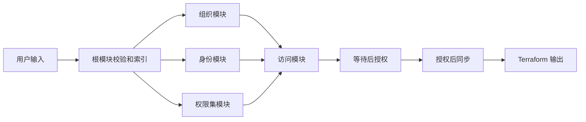

# 当前多账号身份权限模板链路地图 (Context Map)

## 0. 元信息
- 仓库：`terraform-volcenginecc-multi-account-architecture`
- 文档路径：`ai-docs/code_maps/current-template-orchestration.md`
- 生成时间：2026-10-13
- 基线分支/Commit：`dev` / `aacc703`
- 工作区状态：dirty，当前重构包含 31 个已跟踪文件变更及新增模块

## 0.1 入口定位依据与阅读边界
- **输入校验**：`variables.tf` 负责字段校验，`checks.tf` 提供跨输入引用诊断，真实云资源的 `lifecycle.precondition` 负责强制阻断错误引用与缺失密码；校验本身未增加辅助资源。
- **入口定位依据**：根目录是唯一 Terraform Root Module；[`main.tf`](../../main.tf) 编排四个领域模块，[`variables.tf`](../../variables.tf) 定义业务输入，[`locals.tf`](../../locals.tf) 生成稳定授权实例键。
- **已扫描核心文件**：
  - [`main.tf`](../../main.tf)：根模块编排和跨模块依赖。
  - [`variables.tf`](../../variables.tf)：输入类型、默认值和基础校验。
  - [`locals.tf`](../../locals.tf)：公共标签、权限集索引、授权稳定键和同步目标去重。
  - [`modules/organization/main.tf`](../../modules/organization/main.tf)：OU 与成员账号。
  - [`modules/identity/main.tf`](../../modules/identity/main.tf)：用户、用户组和成员关系。
  - [`modules/permission-set/main.tf`](../../modules/permission-set/main.tf)：权限集与策略。
  - [`modules/access/main.tf`](../../modules/access/main.tf)：账号同步等待、访问授权和权限集同步。
  - [`outputs.tf`](../../outputs.tf)：七类结果输出。
- **已确认但未展开的旁路**：InfraManager 上传、创建资源栈和敏感参数注入流程只在 README 中描述，仓库内没有平台侧编排代码。
- **明确未覆盖范围**：真实云端 API 行为、账号可见性延迟、员工登录效果、销毁顺序和目标 InfraManager 引擎兼容性尚未实测。

## 1. 业务目标与范围
用户声明组织、身份、权限和授权关系；Terraform 在一次 Apply、一个 State 中创建 7 种火山引擎云资源，并把逻辑 key 解析为云端 ID，最终形成“主体使用权限集访问目标账号”的关系。

## 2. 链路全貌 (Flow Overview)

## 3. 核心数据结构与状态机
- **组织单元** ([`variables.tf`](../../variables.tf), [`modules/organization/main.tf`](../../modules/organization/main.tf))
  - **核心字段**：`key` 是 Terraform 逻辑键，`name` 是云端名称，`parent_ou_key` 表达父子关系。
  - **固定拓扑**：`ou_core` 和 `ou_workloads` 挂根节点，`ou_production` 挂 `ou_workloads`。
- **成员账号** ([`variables.tf`](../../variables.tf), [`modules/organization/main.tf`](../../modules/organization/main.tf))
  - **核心字段**：`account_name` 同时作为实例键，`org_unit_key` 引用本模板 OU，空值表示根节点。
  - **标签合并**：账号自定义标签 < 公共标签 < `AccountType`，后者覆盖同名键。
- **身份主体** ([`modules/identity/main.tf`](../../modules/identity/main.tf), [`modules/identity/outputs.tf`](../../modules/identity/outputs.tf))
  - **核心字段**：用户和用户组分别用 `key` 建索引；用户组 `member_keys` 引用用户 key。
  - **统一索引**：输出按 `User:key` 或 `Group:key` 生成 `principal_ids`。
- **权限集** ([`modules/permission-set/main.tf`](../../modules/permission-set/main.tf))
  - **核心字段**：`key` 是模块实例键，`permission_policies` 支持 `System` 和 `Inline`。
  - **规范化**：空 `relay_state` 被转换为 `https://console.volcengine.com/`。
- **授权关系** ([`locals.tf`](../../locals.tf), [`modules/access/main.tf`](../../modules/access/main.tf))
  - **稳定键**：`权限集|主体类型|主体|目标账号`。
  - **状态流转**：账号创建完成并返回 ID -> 等待 180 秒；权限集、主体和等待均完成 -> 创建主体访问授权 -> 按 `权限集|账号` 去重同步。

## 4. 主链路执行地图 (Execution Map)

| 阶段 / 步骤 | 关键动作 / 作用 | 核心入口 / 执行函数 | 跨边界 IO / 状态流转 / 副作用 |
| --- | --- | --- | --- |
| **1. 接收输入** | 读取 tfvars 或平台参数 | [`variables.tf`](../../variables.tf) | 密码可从敏感运行参数注入；敏感标记不加密 State |
| **1.1 基础校验** | 校验 key、枚举、密码复杂度、策略 JSON 和重复授权 | [`variables.tf`](../../variables.tf) | 校验失败时停止 Plan |
| **1.2 建立索引** | 生成权限集映射、授权稳定键和去重同步目标 | [`locals.tf`](../../locals.tf) | 无外部 IO；决定 `for_each` 实例地址 |
| **2.1 组织创建** | 串行创建 Core、Workloads、Production OU | [`modules/organization/main.tf`](../../modules/organization/main.tf) | **[云 API]** 创建 OU；显式依赖避免并发修改组织 |
| **2.2 账号创建** | 将账号挂到根节点或指定 OU，并合并标签 | [`modules/organization/main.tf`](../../modules/organization/main.tf) | **[云 API]** 创建成员账号并返回账号 ID |
| **3.1 身份创建** | 创建本地用户并校验每个用户密码 | [`modules/identity/main.tf`](../../modules/identity/main.tf) | **[云 API]** 创建用户；密码进入 Terraform State |
| **3.2 用户组创建** | 用用户 ID 组装成员列表并创建 Manual 用户组 | [`modules/identity/main.tf`](../../modules/identity/main.tf) | **[云 API]** 创建用户组；依赖被引用用户 |
| **4. 权限定义** | 每个逻辑 key 创建一个权限集及完整策略列表 | [`modules/permission-set/main.tf`](../../modules/permission-set/main.tf) | **[云 API]** 创建权限集；与组织、身份分支可并行 |
| **5.0 账号传播缓冲** | 所有账号创建完成并返回 ID 后等待 180 秒 | [`modules/access/main.tf`](../../modules/access/main.tf) | `time_sleep` 引用全部账号 ID；固定缓冲，不是同步就绪检测 |
| **5.1 访问授权** | 绑定主体、权限集和目标账号 | [`modules/access/main.tf`](../../modules/access/main.tf) | **[云 API]** 依赖权限集 ID、主体 ID、账号 ID 和等待完成 |
| **5.2 权限集同步** | 授权完成后按“权限集＋账号”同步一次 | [`modules/access/main.tf`](../../modules/access/main.tf) | **[云 API]** 显式依赖全部 Assignment |
| **6. 结果收口** | 输出 OU、账号、用户、用户组、权限集、授权 ID 和同步状态 | [`outputs.tf`](../../outputs.tf) | 输出写入 Terraform State |

## 5. 关键分支与边界异常
- **OU 串行化**：企业组织不接受并发 OU 修改，因此 Core -> Workloads -> Production 使用显式依赖串行执行。
- **账号归属**：`org_unit_key` 为空时挂根节点；非空时由 check 提供诊断，并由账号资源 precondition 强制验证 OU 引用。
- **组成员引用**：用户组创建时由 check 提供跨输入诊断，并由组资源 precondition 强制验证成员 key 和重复成员。
- **授权引用**：`checks.tf` 提供跨输入诊断，access 资源使用安全查找并通过 precondition 强制验证权限集、主体和账号 key。
- **首次同步**：Assignment 先建立账号、主体和权限集关系；Provisioning 随后按“权限集＋账号”去重同步，避免角色部署记录尚未建立时提前执行。
- **策略更新**：修改权限集策略后需要核对同步状态，必要时在控制台显式重新部署。
- **当前阻塞**：首次部署编排已从“provisioning -> assignment”修正为“等待 -> assignment -> provisioning”；静态校验已通过，仍需真实授权复验。
- **验证边界**：`terraform fmt -check -recursive` 和 `terraform validate -json` 已通过，0 error、0 warning；仓库没有 Terraform Test，修正后的 Assignment、Provisioning、员工登录和 Destroy 尚未实测。

## 6. 功能定位索引 (Feature Locator)

| 功能点 / 问题 | 优先查看 | 相关位置 | 备注 |
| --- | --- | --- | --- |
| 用户要填什么 | [`variables.tf`](../../variables.tf) | [`README.zh-CN.md`](../../README.zh-CN.md) | tfvars 是业务输入，AK/SK 和密码应由运行环境注入 |
| OU 创建顺序 | [`modules/organization/main.tf`](../../modules/organization/main.tf) | [`modules/organization/locals.tf`](../../modules/organization/locals.tf) | 固定三类逻辑 key |
| 账号所属 OU | [`modules/organization/main.tf`](../../modules/organization/main.tf) | [`modules/organization/outputs.tf`](../../modules/organization/outputs.tf) | `org_unit_key` 为空则挂根 |
| 用户和组成员 | [`modules/identity/main.tf`](../../modules/identity/main.tf) | [`modules/identity/outputs.tf`](../../modules/identity/outputs.tf) | 组只能引用本模块创建的用户 |
| 权限策略 | [`modules/permission-set/main.tf`](../../modules/permission-set/main.tf) | [`modules/permission-set/variables.tf`](../../modules/permission-set/variables.tf) | 支持 System 和 Inline |
| 同步为何去重 | [`locals.tf`](../../locals.tf) | [`modules/access/main.tf`](../../modules/access/main.tf) | 按权限集和账号去重 |
| 账号同步等待 | [`modules/access/main.tf`](../../modules/access/main.tf) | [`main.tf`](../../main.tf) | 全部账号返回 ID 后固定等待 180 秒 |
| 授权依赖顺序 | [`modules/access/main.tf`](../../modules/access/main.tf) | [`main.tf`](../../main.tf) | 等待后创建授权，全部授权完成后同步 |
| 部署后看什么 | [`outputs.tf`](../../outputs.tf) | [`README.zh-CN.md`](../../README.zh-CN.md) | 检查授权任务和同步状态，再做员工登录验证 |

## 7. deep-analyze 下钻建议

| 候选链路 / 函数 / 模块 | 为什么需要下钻 | 建议分析入口 |
| --- | --- | --- |
| 跨变量引用完整性 | 已增加 check 和资源 precondition，仍需错误输入回归测试 | [`variables.tf`](../../variables.tf) |
| 账号创建后的可见性 | 账号创建完成后固定等待 180 秒；真实同步就绪仍需复验 | [`modules/access/main.tf`](../../modules/access/main.tf) |
| State 迁移兼容性 | 模块地址大幅变化且 moved 块已移除，已有 State 升级风险未核实 | [`main.tf`](../../main.tf) |
| 销毁依赖 | assignment、provisioning、账号和 OU 的真实销毁约束尚未演练 | [`modules/access/main.tf`](../../modules/access/main.tf) |
